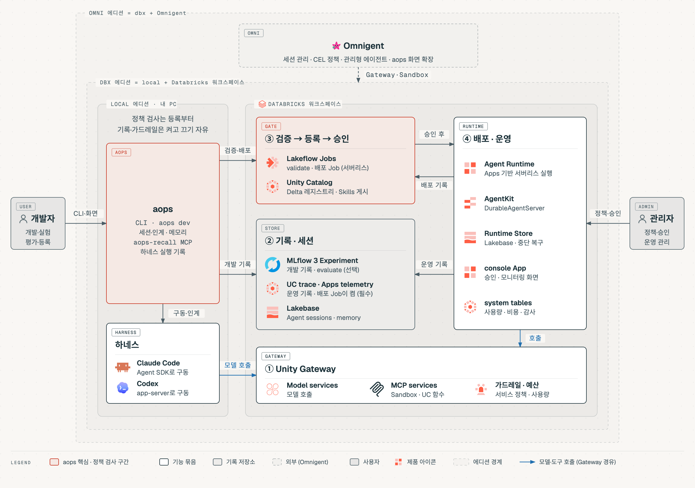

# aops

AgentOps(`aops`)는 Databricks 위에서 AI 에이전트를 만들고, 실험·평가하고, 등록·배포하고, 운영하는 전 과정을 하나로 묶는 오픈소스 도구입니다. 에이전트 실행은 Claude Code·Codex 같은 하네스가, 모델 호출·기록·검증·배포·운영 화면은 Databricks 기능이 맡고, aops는 이것들을 프로젝트 정의 하나(`aops.toml`)와 명령으로 연결합니다.

## 아키텍처

- **경계:** local은 내 PC, dbx는 local에 Databricks 워크스페이스를 더한 것, omni는 dbx에 Omnigent를 더한 것입니다.
- **① Unity Gateway:** 하네스와 배포된 에이전트가 모델·도구를 부르는 경로입니다. 사용량·예산·서비스 정책(가드레일)이 여기서 적용됩니다. dbx에서 권장하지만 강제하지 않습니다.
- **② 기록·세션:**
  - 개발 기록은 aops가 본인 MLflow Experiment에 남기고, 사용자가 끌 수 있습니다.
  - 운영 기록은 배포 Job이 배포된 에이전트에 MLflow tracing과 Apps telemetry를 켜서 남깁니다. 정책상 필수입니다.
  - 세션·메모리는 Lakebase 기반 Agent sessions·memory에 저장해 다른 PC에서도 이어 갑니다.
- **③ 검증 → 등록 → 승인 (강제 구간):** `validate`는 Lakeflow Job으로 돌고, 레지스트리·승인 기록은 Unity Catalog Delta 테이블에 남습니다. 등록할 때 스킬을 Unity Gateway Skills로 게시합니다.
- **④ 배포·운영:** 승인된 버전만 배포 Job이 Agent Runtime(Databricks Apps)에 배포합니다. 관리자는 console App에서 승인하고 운영 현황을 봅니다.

## 주요 기능

- **하네스를 바꿔도 이어지는 세션·메모리:** Claude Code에서 Codex로 넘어가도 같은 대화를 계속합니다. dbx에서는 Agent sessions·memory(Lakebase)에 저장해 다른 PC에서도 이어 갑니다.
- **구성별 나란히 비교:** 같은 질문을 하네스·모델·가드레일 구성별로 반복 실행해 답변·도구 사용률·토큰·지연을 비교합니다. 실행마다 MLflow trace가 남습니다.
- **평가와 가드레일 시험:** MLflow 평가로 채점하고, 레드팀 사례로 가드레일(지시·규칙·Unity Gateway 서비스 정책)의 차단·오탐을 확인합니다.
- **개발은 자유, 등록부터 강제:** 개발 중에는 hook·기록·가드레일을 마음대로 켜고 끕니다. 등록·배포할 때만 Lakeflow Job이 관리자 정책을 코드로 검사합니다.
- **승인 후 배포:** 배포 요청 → console App(Databricks App)에서 승인 → 배포 Job이 Agent Runtime에 배포합니다. 요청·승인·배포 이력은 Unity Catalog Delta 테이블에 남습니다.
- **운영 모니터링:** 사용량·예산·비용, 실행 중인 에이전트와 MCP를 console App과 CLI로 봅니다(system tables, Apps telemetry).

## 핵심 명령어

| 명령 | 하는 일 |
| --- | --- |
| `aops init <name>` | 프로젝트 폴더와 하네스 설정 만들기 |
| `aops dev` | 개발 화면(Chat·Batch·Evaluate·기록). Agent Bricks 프로젝트면 채팅 화면도 함께 |
| `aops run <questions.yaml> --variants a,b` | 질문 × 구성 × 반복 실행과 비교표 |
| `aops evaluate [--suite redteam]` | MLflow 채점, 가드레일 시험 |
| `aops session switch --harness codex` | 하네스 전환, 맥락 이어 붙이기 |
| `aops validate` | 관리자 정책 검사 (Lakeflow Job, 강제 시작) |
| `aops register --version x.y.z` | 검증을 통과한 소스 등록 (UC 모델 버전, 스킬 게시) |
| `aops deploy --version x.y.z` | 배포 요청 → console App 승인 → Agent Runtime 배포 |
| `aops promote <version>` | 운영 버전 지정, 이전 버전이면 되돌리기 |
| `aops monitor [--web]` | 사용량·예산·비용, 실행 중인 에이전트와 MCP |

전체 16개 명령과 옵션은 [명령어 문서](docs/commands.md)에 있습니다.

## 문서

| 문서 | 내용 |
| --- | --- |
| [개요](docs/overview.md) | 개발부터 운영까지 단계마다 쓰는 Databricks 기능, 원칙, 사용자, 에디션 |
| [명령어](docs/commands.md) | 16개 명령의 사용법·옵션·에디션별 동작 |
| [프로젝트 폴더](docs/project.md) | `aops init`이 만드는 폴더 구조와 `aops.toml` |
| [레지스트리·승인](docs/registry.md) | 관리자 정책, console App, 레지스트리 테이블 (dbx) |

## 라이선스

[MIT](LICENSE)
